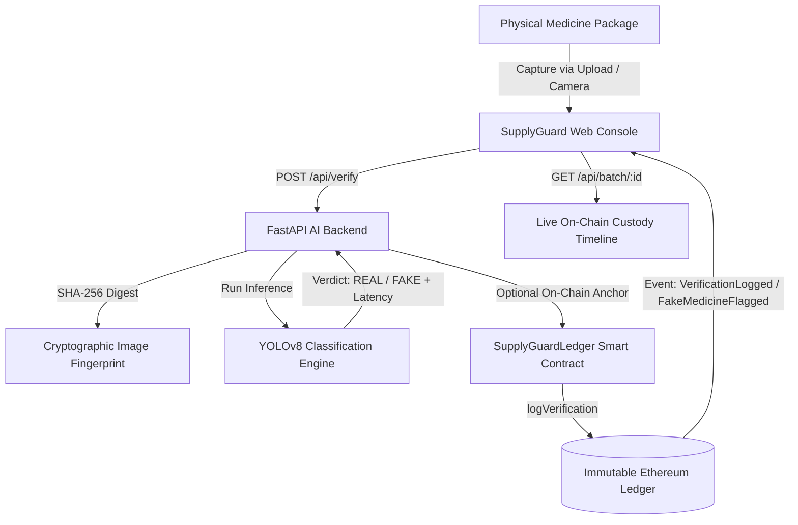

<div align="center">

# 🛡️ SupplyGuard
### AI-Powered Counterfeit Medicine Detection & Immutable Blockchain Provenance

[](LICENSE)
[](https://github.com/ultralytics/ultralytics)
[](https://soliditylang.org/)
[](https://fastapi.tiangolo.com/)
[](https://hardhat.org/)
[](#smart-contract-tests)

<p align="center">
  <b>Defending the global pharmaceutical supply chain from counterfeit and synthetic packaging through computer vision intelligence and tamper-evident Web3 ledger audits.</b>
</p>

</div>

---

## 📌 Executive Summary

**SupplyGuard** is a dual-tier pharmaceutical integrity system that combines:
1. **Edge AI Classification (YOLOv8)**: Instant binary classification of medicine packaging as **`REAL`** or **`FAKE`** with calibrated confidence scores, dual-class probability breakdown, and sub-50ms inference latency.
2. **Immutable Blockchain Provenance (Solidity & Hardhat)**: An append-only Ethereum smart contract ledger documenting physical supply-chain custody (`Manufactured` → `Packaged` → `Warehouse` → `Distributor` → `Retailer`) and anchoring cryptographic SHA-256 image hashes with AI verification verdicts.
3. **Cyber-Pharma Web Dashboard**: A modern, responsive browser console featuring live drag-and-drop inspection, clipboard paste, real-time webcam scanning, 1-click test presets, on-chain custody timeline explorer, and printable audit certificates.

---

## 🏛️ System Architecture



---

## ⚡ Key Capabilities

### 1. Computer Vision & Synthetic Defense
- **Lightweight Binary Classifier**: Built upon `yolov8n-cls` trained specifically on genuine, known counterfeit, and diffusion-generated synthetic counterfeit medicine packaging.
- **Leakage-Resistant Dataset**: Generates synthetic training variants exclusively from training images, while validating against completely unseen synthetic variants generated from held-out test sets.
- **Dual Class Probabilities**: Full transparency displaying granular probability distributions (e.g. `REAL: 99.92% | FAKE: 0.08%`).

### 2. Immutable Web3 Ledger (`SupplyGuardLedger.sol`)
- **Append-Only History**: Records cannot be overwritten, modified, or deleted once mined.
- **Cryptographic Hash Anchoring**: Only the off-chain image digest (SHA-256) is recorded on-chain, preserving privacy and eliminating gas bloat.
- **Tamper-Evident Chaining**: Records link cryptographically to the `previousRecordId`, creating an unbroken audit trail for regulatory compliance.
- **Access Control**: Role-gated authorization for certified manufacturers and verified logistics operators.

### 3. High-Security Web Console & Diagnostics
- **1-Click Demo Presets**: Test real, counterfeit, and synthetic packages instantly with pre-loaded samples.
- **Multimodal Ingestion**: Supports drag-and-drop, native file browsing, clipboard paste (`Cmd+V` / `Ctrl+V`), and live webcam scanning.
- **Batch Custody Timeline Explorer**: Interactive modal querying smart contract state directly to inspect the complete chain of custody for any batch.
- **Certificate Generation**: Exportable, tamper-evident audit report ready for printing or compliance filing.
- **Adaptive Cyber-Pharma Theme**: High-contrast dark mode with glowing status indicators and a laboratory light mode.

---

## 📊 Measured Model Performance

Evaluated against the held-out test split (`dataset/prepared/test/`):

| Metric | Benchmark Performance | Interpretation |
| :--- | :---: | :--- |
| **Overall Test Accuracy** | **98.00%** | Exceptional end-to-end binary accuracy across all held-out images. |
| **Fake Precision** | **100.00%** | **Zero false alarms**: not a single genuine package was wrongly flagged. |
| **Fake Recall** | **94.44%** | Caught **34 out of 36** actual counterfeit test packages. |
| **Real F1-Score** | **98.46%** | High balance between precision and recall on authentic medicine. |
| **Synthetic Fake Detection** | **96.67%** | Strong generalizability against unseen AI-generated counterfeits. |

---

## 📁 Repository Structure

```text
├── contracts/
│   └── SupplyGuardLedger.sol       # Solidity append-only custody & verification contract
├── backend/
│   ├── main.py                     # FastAPI service, YOLO inference, and blockchain bridge
│   └── __init__.py
├── frontend/
│   ├── index.html                  # Cyber-pharma verification console & timeline modals
│   ├── styles.css                  # Modern responsive design system (dark/light theme)
│   ├── app.js                      # Client controller, camera capture, drag-drop, API fetch
│   └── samples/                    # 1-click test packages (Real, Fake, Synthetic)
├── dataset/
│   ├── Fake/                       # Raw counterfeit samples
│   ├── Real/                       # Raw genuine medicine packages
│   └── prepared/                   # Leakage-aware splits (train, val, test, synthetic_test)
├── runs/
│   ├── classification/             # YOLOv8 checkpoint weights (best.pt)
│   ├── evaluation/                 # Metrics CSV, confusion matrices, prediction logs
│   └── blockchain/                 # Local deployment address registry (deployment.json)
├── scripts/
│   ├── deploy.js                   # Hardhat deployment script
│   ├── demo.js                     # Seed sample batch custody records (SG-BATCH-001)
│   ├── record-verification.js      # On-chain AI verification transaction logger
│   └── get-batch-history.js        # On-chain batch history query utility
├── src/
│   ├── data/                       # Dataset validation and preparation pipelines
│   ├── synthetic/                  # Stable Diffusion / augmentation counterfeit generator
│   ├── training/                   # YOLOv8 training scripts with Apple MPS / CUDA support
│   ├── evaluation/                 # Comprehensive test set evaluator
│   └── inference/                  # CLI inference utility
├── test/
│   └── SupplyGuardLedger.test.js   # 11 unit tests for smart contract validation
├── hardhat.config.js               # Hardhat configuration (local & Sepolia networks)
├── package.json                    # Node dependencies, scripts, and dev tools
├── requirements.txt                # Python dependencies (PyTorch, Ultralytics, FastAPI)
└── README.md
```

---

## 🚀 Quick Start Guide

### Prerequisites
- **Node.js** (v18 or higher) & **npm**
- **Python** (v3.10 – v3.12 recommended)
- **Git**

---

### Step 1: Clone & Install Dependencies

```bash
# 1. Clone repository
git clone https://github.com/salianabhy/supplyGuard.git
cd supplyGuard

# 2. Install JavaScript / Hardhat dependencies
npm install

# 3. Create and activate Python virtual environment
python3.12 -m venv .venv
source .venv/bin/activate       # On Windows: .venv\Scripts\activate

# 4. Install Python dependencies
pip install --upgrade pip
pip install -r requirements.txt
```

---

### Step 2: Compile & Test Smart Contracts

```bash
# Compile Solidity contracts
npm run compile

# Run all 11 unit tests
npm test
```

Expected output:
```text
  SupplyGuardLedger
    ✔ deploys and authorizes the deployer
    ✔ creates a new batch and emits events
    ✔ records supply-chain events with actor addresses and timestamps
    ✔ stores REAL verification records
    ✔ stores FAKE verification records and emits fake flag event
    ✔ rejects invalid verdicts and invalid confidence scores
    ✔ rejects duplicate hashes
    ✔ rejects reuse of an AI verification hash
    ✔ keeps history append-only through correction events
    ✔ returns complete batch history
    ✔ blocks unauthorized batch creation and event recording

  11 passing (2s)
```

---

### Step 3: Run the Full System (Local Demo)

Open three terminal tabs in the project directory:

#### **Terminal 1: Start Local Blockchain Node**
```bash
npx hardhat node
```
*Starts a local Ethereum JSON-RPC node at `http://127.0.0.1:8545`.*

#### **Terminal 2: Deploy Contract & Seed Sample Batch**
```bash
# Deploy contract locally
npm run deploy:local

# Seed sample batch (SG-BATCH-001) with manufacturing, warehouse, and distributor history
npx hardhat run scripts/demo.js --network localhost
```

#### **Terminal 3: Start SupplyGuard API & Web Console**
```bash
source .venv/bin/activate
npm run api
```
*Starts the FastAPI server with live auto-reload at **`http://127.0.0.1:8001`** (or port 8000).*

---

## 🖥️ Using the Web Application

1. Open **[http://127.0.0.1:8001](http://127.0.0.1:8001)** in your web browser.
2. **Select an Inspection Image**:
   - Click one of the **1-Click Demo Samples** (e.g. *Genuine Paracetamol 500mg* or *Tampered Counterfeit Carton*), or
   - Drag and drop an image, paste from clipboard (`Cmd+V`), or click **Camera** to scan with your webcam.
3. **Configure Batch Tracking**:
   - Batch ID: Enter `SG-BATCH-001`.
   - Check **Anchor audit on local Ethereum ledger**.
4. **Click "Run YOLO Verification"**:
   - View the instantaneous classification verdict (**`REAL`** or **`FAKE`**).
   - Inspect the dual probability breakdown and telemetry metrics (latency in ms, image resolution).
   - View the mined transaction hash on the local blockchain.
5. **Explore Batch Custody**:
   - Click **Batch Timeline** or **View On-Chain History** to open the interactive modal displaying every custodial handover and verification event.

---

## 🧪 CLI Verification & Evaluation

### Run CLI Prediction
```bash
python -m src.inference.predict \
  --model runs/classification/supplyguard_yolov8_cls-3/weights/best.pt \
  --image dataset/prepared/test/Real/images04.jpg
```

### Run Model Evaluation Suite
```bash
python -m src.evaluation.evaluate \
  --model runs/classification/supplyguard_yolov8_cls-3/weights/best.pt \
  --dataset dataset/prepared \
  --output-dir runs/evaluation/supplyguard_yolov8_cls-3 \
  --imgsz 224
```

---

## 📡 API Reference

| Endpoint | Method | Parameters | Description |
| :--- | :---: | :--- | :--- |
| `/` | `GET` | None | Serves the responsive verification dashboard. |
| `/api/health` | `GET` | None | Health check, model availability status, and path. |
| `/api/verify` | `POST` | `image` (file), `batch_id` (str), `location` (str), `record_blockchain` (bool) | Ingests medicine package image, performs YOLO inference, computes SHA-256 hash, and optionally logs to Ethereum ledger. |
| `/api/batch/{batch_id}` | `GET` | `batch_id` (path str) | Queries smart contract on-chain and returns the complete chronological provenance timeline. |

---

## 🔒 Security & Privacy Architecture

- **Off-Chain Asset Storage**: Raw package photos are never stored on the blockchain, eliminating privacy risks and astronomical storage gas costs. Only irreversible SHA-256 hashes are logged.
- **Append-Only Immutability**: The contract contains no `delete` or `update` functions. Any corrections require linked compensation events.
- **Duplicate Hash Guard**: Re-submission of existing image hashes or event hashes is rejected at the smart contract level.
- **Zero Hardcoded Secrets**: Private keys and RPC URLs are read exclusively from environment variables (`.env`).

---

## 📄 License

This project is licensed under the [MIT License](LICENSE).
